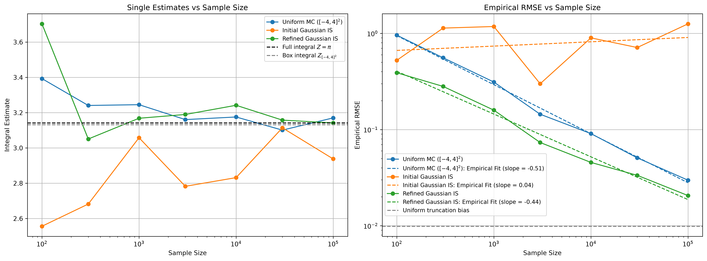

# Monte Carlo Normalizing Constant Estimation

通过二维非线性目标，研究 Uniform Monte Carlo、Gaussian Importance Sampling 和建议分布设计对积分估计的影响。

当前已完成通用估计器、Gaussian 参数调优、三种方法的初步实验，以及精确目标采样的实现。重点是区分有限样本表现、截断偏差和重要性权重的尾部性质。



## 问题与真值

目标未归一化密度为

$$
\widetilde\rho(x_1,x_2)
=\exp\left[-\frac{x_1^2}{2}
-\frac{(2x_2+x_1^2-1)^2}{2}\right],
\qquad
Z=\int_{\mathbb R^2}\widetilde\rho(x)\,dx.
$$

高密度区域沿曲线 $x_2=(1-x_1^2)/2$ 分布。令 $u=x_1$、$v=2x_2+x_1^2-1$，逆变换的 Jacobian 绝对值为 $1/2$，所以

$$
Z=\frac12\int_{\mathbb R^2}e^{-(u^2+v^2)/2}\,du\,dv=\pi.
$$

Uniform MC 在 $[-4,4]^2$ 上估计的是截断积分：

$$
Z_{[-4,4]^2}\approx3.131708411797,
\qquad
Z-Z_{[-4,4]^2}\approx0.009884241793.
$$

它对截断积分无偏，但对完整积分有固定截断偏差。当前所有方法的经验 RMSE 都以完整真值 $\pi$ 计算，因此包含 Uniform 的截断误差。

## 当前方法与结果

| 方法 | 抽样分布 |
|---|---|
| Uniform MC | $U([-4,4]^2)$ |
| Initial Gaussian IS | $N((0,0.5),\operatorname{diag}(1,0.25))$ |
| Refined Gaussian IS | $N((0,0),\operatorname{diag}(0.99914662,4.61945853))$ |

现有实验使用 $N\in\{100,300,1000,3000,10000,30000,100000\}$，每个 N 重复 100 次计算经验 RMSE。以下数值来自 `results/` 中的三份 CSV：

| N | Uniform MC | Initial Gaussian IS | Refined Gaussian IS |
|---:|---:|---:|---:|
| 10,000 | 0.090777 | 0.898071 | 0.045556 |
| 100,000 | 0.029765 | 1.256077 | 0.020604 |

调整后的 Gaussian 在当前各个 N 下都获得更低的经验 RMSE。图中的幂律拟合仅描述这批结果，不用于证明理论收敛阶。

实验入口当前使用 seed `20260930`；调参与评价尚未采用明确分离的随机流，因此这些结果属于初步实验，仍需独立评价。

### 精确采样对照

本题可以直接生成归一化目标分布的独立样本：

$$
X_1\sim N(0,1),\qquad
X_2\mid X_1=x\sim N\left(\frac{1-x^2}{2},\frac14\right).
$$

实现位于 `experiments/exact.py`。对应密度 $q=\widetilde\rho/\pi$，重要性权重恒为 $\pi$，可作为零方差 oracle 对照和实现自检。它利用了本题的解析结构，不代表一般未知归一化常数问题的通用解法。

当前该入口仍调用通用 log-log RMSE 绘图；零 RMSE 会触发正值检查，因此完整脚本的零值绘图尚待处理。精确对照不纳入上面的三方法比较图。

## 环境与运行

当前本地环境：Python 3.12.4、NumPy 2.5.4、SciPy 1.18.1、Matplotlib 3.11.2。以下为 Windows PowerShell 命令，均在仓库根目录执行。

创建环境并安装主实验依赖：

```powershell
python -m venv .venv
.\.venv\Scripts\python.exe -m pip install numpy scipy matplotlib
```

以上安装命令不锁定版本；尚未验证干净环境的完整复现。

**快速查看已有结果**，只读取已保存的 CSV，不重新采样：

```powershell
.\.venv\Scripts\python.exe -m experiments.comparison
```

输出为 `figures/comparison.png`。程序使用非交互绘图后端，直接保存图片。

如需重新生成三组实验结果，依次运行以下命令。默认预算较大，会覆盖同名 CSV 和图片：

```powershell
.\.venv\Scripts\python.exe -m experiments.uniform_truncated
.\.venv\Scripts\python.exe -m experiments.gaussian
.\.venv\Scripts\python.exe -m experiments.refined_gaussian
.\.venv\Scripts\python.exe -m experiments.comparison
```

Gaussian 调参是独立入口，生成比较图不需要重跑它：

```powershell
.\.venv\Scripts\python.exe -m experiments.find_refined_is
```

该入口打印候选参数和优化器的终止状态，不会自动更新 `refined_gaussian.py` 中的固定参数。

## 代码与结果组织

| 位置 | 内容 |
|---|---|
| `src/target.py` | 目标密度、log-target、解析真值及截断数值积分 |
| `src/proposals.py` | 通用 proposal、Uniform 和 Gaussian 抽样与密度 |
| `src/estimators.py` | 通用 IS 估计、重复估计、经验 RMSE 和 bias |
| `src/evaluations.py` | 根据估计值数组计算评价指标 |
| `src/experiments.py` | 遍历 N、输出 CSV 并绘图 |
| `src/plotting.py` | 样本可视化、估计曲线、经验 RMSE 和拟合线 |
| `experiments/` | 具体实验、调参、精确采样及合并比较入口 |
| `results/` | 实验汇总 CSV |
| `figures/` | 单方法图与三方法比较图 |
| `notebooks/` | 基础模拟与方差缩减的学习实验 |
| `reports/` | 新报告的 LaTeX 草稿，目前尚无分析正文 |

三方法比较图读取 `uniform_truncated_4.csv`、`gaussian.csv` 和 `refined_gaussian.csv`，可从已有结果重建。

CSV 的 `Estimate` 是一次单独估计，`RMSE` 则来自另外 100 次重复；它们不是同一批估计的均值和误差。每个 N 共使用 $(R+1)N$ 个样本，目前尚未保存重复估计的原始数组、运行时间及完整配置。

## 结论边界与下一步

- Gaussian IS 对本题完整积分无偏，但任意非退化二维 Gaussian proposal 的重要性权重二阶矩无限。有限重复得到的经验 RMSE 和拟合斜率不能证明有限方差或通常的 $N^{-1/2}$ RMSE 规律。
- Uniform 对完整积分的理论 RMSE 包含截断偏差；增大 N 不能消除约 `0.009884` 的误差下限。
- 当前结果尚不足以宣称某种方法在所有预算和随机种子下都更优，也未比较计算时间。
- 下一步保存每次重复估计及实验配置，使用独立于调参的随机流评价固定方案，并补充估计值分布、log-weight 诊断和报告分析。

## License

[MIT](LICENSE)
